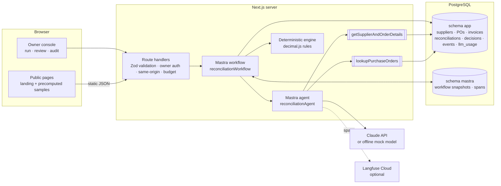

# Architecture

InvoiceMatch AI is one Next.js (App Router, Node.js runtime) application. Mastra runs in the same server process; there is no long-running worker.

## Agent vs workflow

- The **workflow** owns the process: validation, persistence, ordering, the review gate and terminal state. It is a named Mastra workflow (`createWorkflow` + `createStep`), not a function pretending to be one.
- The **agent** is called only for interpretation that deterministic code cannot do: choosing a purchase order when the invoice has no usable reference, and proposing line correspondences when SKUs do not match exactly. It can only read through two tools whose supplier scope is set by the server in Mastra's `requestContext`, never by the model.
- The **deterministic engine** (`src/domain/reconcile.ts`) decides every money comparison and the automatic status. Agent output is validated (Zod + database existence + supplier/status checks) and can only *add* findings (`PO_SELECTED_BY_AGENT`, `LINE_SEMANTIC_MAPPING`, `LOW_AGENT_CONFIDENCE`); it can never remove one.

## Workflow steps

| # | Step | Writes | Notes |
|---|---|---|---|
| 1 | `validate-input` | — | Zod: decimal strings only, no negatives, NaN, exponents; supplier must exist |
| 2 | `persist-invoice-and-run` | invoice, invoice lines, reconciliation (`PROCESSING`), `CREATED` event | One transaction. Unique idempotency key; a racing duplicate rolls back and `bail()`s |
| 3 | `agent-lookup-mapping` | `AGENT_STEP` event, trace id | Explicit PO number first, SKU mapping second, agent only for the rest. Any agent/model error → `FAILED` with an error code, then `bail()` |
| 4 | `deterministic-reconcile` | result JSON, status `MATCHED`/`REVIEW_REQUIRED`/`UNMATCHED`, `RECONCILED` event | Conditional update `where status = 'PROCESSING'` |
| 5 | `review-gate` | `SUSPENDED_FOR_REVIEW` event | `MATCHED` passes through. Otherwise real `suspend()`; on resume, re-reads the persisted decision |
| 6 | `persist-terminal-state` | status, decision `RESUMED`, `FINALIZED` event | Conditional update from a pending status only |

## Durable human-in-the-loop

1. `POST /api/reconciliations/:id/decision` locks the reconciliation row, checks it is pending and inserts the decision (`unique(reconciliation_id)`, `unique(idempotency_key)`) plus a `DECISION_RECORDED` event, in one transaction.
2. Only then it loads the run by `workflow_run_id` (`createRun({ runId })`) and calls `run.resume({ step: "review-gate", resumeData })`. Nothing lives in memory between suspend and resume: the snapshot is in `mastra.mastra_workflow_snapshot`.
3. If the process dies between 1 and 2, the decision stays `resume_status = PENDING`; replaying the same request or `recoverPendingResumes()` completes it. A concurrent resume that loses Mastra's claim (`WORKFLOW_RESUME_ALREADY_CLAIMED`) is treated as success because the decision row already fixes the outcome.

Mastra internals and business tables are not in one database transaction; the decision row is the source of truth and every state change is a conditional, idempotent update. This is tested (`tests/integration/workflow.test.ts`, `restart.test.ts`).

## Status transitions

| From | To |
|---|---|
| `PROCESSING` | `MATCHED`, `REVIEW_REQUIRED`, `UNMATCHED`, `FAILED` |
| `REVIEW_REQUIRED` | `APPROVED_WITH_EXCEPTION`, `REJECTED` |
| `UNMATCHED` | `APPROVED_WITH_EXCEPTION`, `REJECTED` |
| `MATCHED`, `APPROVED_WITH_EXCEPTION`, `REJECTED`, `FAILED` | terminal |

`APPROVED_WITH_EXCEPTION` records a human decision only. No payment or external side effect exists in this system.

## Money and rounding policy

- Amounts, quantities and tax rates travel as decimal strings and are computed with `decimal.js` (40 significant digits).
- line subtotal = round(quantity × unit price); line tax = round(line subtotal × tax rate); subtotal = Σ line subtotals; tax = Σ line taxes; total = subtotal + tax.
- `round` is ROUND_HALF_UP to the currency's minor units (EUR/USD/GBP 2, JPY 0).
- Zero tolerance: any difference after rounding is a finding. Declared totals are compared, never overwritten.
- Different currencies are flagged (`CURRENCY_MISMATCH`) and totals are not compared; no conversion.

## Rule catalogue

`INV_LINE_ARITHMETIC`, `INV_SUBTOTAL_ARITHMETIC`, `INV_TAX_ARITHMETIC`, `INV_TOTAL_ARITHMETIC`, `DUPLICATE_INVOICE`, `PO_NOT_FOUND`, `PO_AMBIGUOUS`, `PO_SELECTED_BY_AGENT`, `PO_REFERENCE_MISMATCH`, `SUPPLIER_MISMATCH`, `CURRENCY_MISMATCH`, `PO_CLOSED`, `LINE_UNMATCHED_INVOICE`, `LINE_MISSING_ON_INVOICE`, `LINE_SEMANTIC_MAPPING`, `LINE_SKU_MISMATCH`, `LINE_QUANTITY_MISMATCH`, `LINE_UNIT_PRICE_MISMATCH`, `LINE_TAX_RATE_MISMATCH`, `TOTAL_VS_PO_MISMATCH`, `LOW_AGENT_CONFIDENCE`.

Each finding carries `severity`, the invoice field/line ID, the PO field/line ID, `actual`, `expected` and the exact `delta`.

## Persistence

- `app` schema: business tables (`migrations/0001_business_schema.sql`). Kept out of `public` so that on Supabase it is not exposed through the Data API.
- `mastra` schema: created by `@mastra/pg` `PostgresStore` (`schemaName: "mastra"`). A snapshot is keyed by workflow name + `runId`; `app.reconciliations.workflow_run_id` stores that `runId`.
- Triggers make `reconciliation_events` append-only and the decision fields of `review_decisions` immutable.

## Security model

- Public: landing page, precomputed samples (`data/samples/precomputed.json`), scenario list, health. No database writes, no model calls.
- Owner-only: every route that reads run internals or mutates state. Checked server-side in each handler (`src/server/http.ts`), plus a same-origin check for mutations, 32 KB body limit, per-process rate limits.
- Auth adapters (`src/server/auth.ts`): `local` (passphrase → HMAC-signed HttpOnly cookie, refused when `VERCEL`/`DEPLOYED` is set) and `supabase` (`src/server/supabase-auth.ts`: magic link with PKCE, `POST /api/auth/magic-link` → email → `GET /auth/callback` exchanges the code with the HttpOnly verifier cookie, checks the allowlist and issues the same signed session tagged `via: "supabase"`). Sessions are only valid while `AUTH_MODE` matches how they were minted. Non-owner emails get an identical response and never reach Supabase.
- Spend: `AGENT_MODE=mock` by default. In `anthropic` mode the call fails closed without a key and reserves its worst-case cost in `app.llm_usage` under an advisory lock before any request (`LLM_BUDGET_USD`, `LLM_MAX_REQUESTS`). This complements, and does not replace, the Claude Console spend limit.

## Observability

Mastra observability creates spans for the workflow run, each step, the agent run, model generation and every tool call, under one trace whose id is stored on the reconciliation. The Langfuse exporter is registered only when both Langfuse keys exist; without keys nothing leaves the process. The instrumentation is verified offline with Mastra's `TestExporter` (`tests/integration/tracing.test.ts`).
